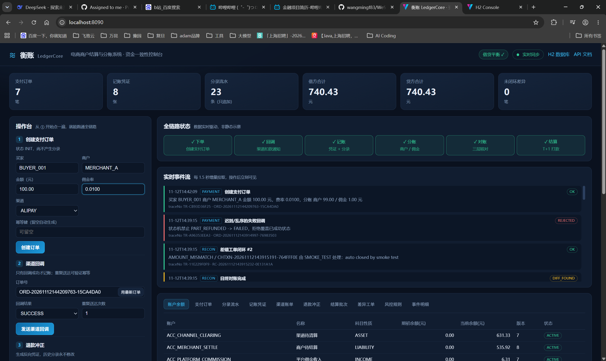

# 衡账 LedgerCore · 运行与操作手册

电商商户结算与分账系统。**所有操作都能在网页上手动完成，数据真实落到数据库，页面实时显示每一笔变动。**

- 主控制台：<http://localhost:8090>
- H2 数据库控制台：<http://localhost:8090/h2-console>
- Swagger API 文档：<http://localhost:8090/swagger-ui.html>

## 界面预览



> 运行中的控制台：顶部 KPI 与借贷平衡校验、左侧七步操作台、右侧全链路状态与实时事件流、下方九个数据面板。图中所有数字都来自真实落库的分录与账户余额，不是静态示意。

---

## 一、怎么启动

### 环境要求（本机已具备）

| 项 | 本机情况 |
|---|---|
| JDK 17 | `Eclipse Adoptium 17.0.20` |
| Maven | IDEA 自带 `3.9.16`（不在 PATH，`start.cmd` 会自动找） |
| Node.js | `v24`（仅用于端到端自检脚本，可选） |
| 数据库 | 无需安装，使用 H2 文件库 |

### 方式 A：一键启动（推荐）

在项目根目录 `c:\Users\xiezhenyu\CodeBuddy\jinrong` 下：

```
start.cmd
```

双击文件，或在命令行里执行都可以。脚本会：

1. 自动探测 `mvn`，找不到就回退到 IDEA 自带 Maven；
2. 执行 `clean package -DskipTests`（首次会下载依赖，约 1–3 分钟，之后走本地缓存）；
3. 运行 `bootstrap\target\ledgercore.jar`。

看到 `Started LedgerCoreApplication` 后打开 <http://localhost:8090>。日志同时写入 `app.log`。
**停止**：在运行窗口按 `Ctrl+C`，或直接关闭该窗口。

### 方式 B：手动构建启动

```
call "C:\Program Files\JetBrains\IntelliJ IDEA 2026.2.1\plugins\maven-plugin\lib\maven3\bin\mvn.cmd" clean package -DskipTests
java -jar bootstrap\target\ledgercore.jar
```

> 应用当前**已经在运行**。如果只是想打开页面看效果，直接访问 <http://localhost:8090> 即可，不必重新启动。

### 自检

```
node smoke-test.mjs
```

会跑完整链路（下单 → 回调 → 幂等 → 退款冲正 → 对账 → 结算 → 造数 → 异常检出 → 工单闭环），当前结果 **20 项全通过**。单元测试：

```
call "C:\Program Files\JetBrains\IntelliJ IDEA 2026.2.1\plugins\maven-plugin\lib\maven3\bin\mvn.cmd" test
```

`LedgerRulesTest` 共 7 个用例，覆盖借贷平衡、科目方向、分账守恒、状态机与金额精度。

---

## 二、页面长什么样、数据流在哪看

页面分三块：

- **顶部 KPI**：订单数 / 凭证数 / 分录数 / 借方合计 / 贷方合计 / 未闭环差异，右上角显示「借贷平衡 ✓」。
- **左侧操作台**：7 个步骤，每个都是可填参数的表单，点按钮即发真实请求。
- **右侧**：
  - **全链路状态**：下单 → 回调 → 记账 → 分账 → 对账 → 结算，按真实数据点亮；
  - **实时事件流**：每 1.5 秒增量拉取新事件，任何一次操作、拦截、拒绝、差异都会带 `traceNo` 显示出来；
  - **9 个数据面板**：账户余额、支付订单、分录流水、记账凭证、渠道账单、退款冲正、结算批次、差异工单、风控规则。

刷新节奏：事件流 1.5 秒、KPI 3 秒、当前表格 6 秒，每次操作完成后立即刷新一次。所以你点完按钮，余额和分录会当场变化。

**想看「真实落库」**：打开 <http://localhost:8090/h2-console>，连接参数：

| 字段 | 值 |
|---|---|
| JDBC URL | `jdbc:h2:file:./data/ledgercore;MODE=MySQL;DATABASE_TO_LOWER=TRUE;AUTO_SERVER=TRUE` |
| User Name | `sa` |
| Password | 留空 |

数据文件是 `data/ledgercore.mv.db`，重启应用不丢失。可以直接执行：

```sql
SELECT * FROM account;
SELECT * FROM account_entry ORDER BY id DESC;
SELECT voucher_no, SUM(CASE WHEN direction='DR' THEN amount_cent ELSE 0 END) dr,
       SUM(CASE WHEN direction='CR' THEN amount_cent ELSE 0 END) cr
FROM account_entry GROUP BY voucher_no;
SELECT * FROM event_log ORDER BY id DESC;
```

---

## 三、怎么在前端手动造数据测试（5 分钟完整走一遍）

> 建议先点左侧最下方「清空数据」，从干净状态开始。

### ① 创建支付订单

保持默认值：买家 `BUYER_001`、商户 `MERCHANT_A`、金额 `100.00`、佣金率 `0.0100`、渠道 `WECHAT`，点 **创建订单**。

- 可以看到：事件流出现「创建支付订单」；订单面板多一条 `INIT` 记录；
- **此时没有任何分录、账户余额不变**——因为渠道还没扣款。
- 订单号会自动填进第 ② ③ 步的输入框；也可以点「用最新订单」手动填。

### ② 渠道回调（真正记账）

点 **发送渠道回调**。

资金流：`100.00 = 商户应收 99.00 + 平台佣金 1.00`，生成一张凭证、三条分录：

| 账户 | 科目性质 | 方向 | 余额变化 |
|---|---|---|---|
| 渠道待清算 | ASSET | 借 DR | +100.00 |
| 商户待结算 | LIABILITY | 贷 CR | +99.00 |
| 平台佣金收入 | INCOME | 贷 CR | +1.00 |

借方合计 = 贷方合计 = 100.00，右上角「借贷平衡 ✓」。切到「分录流水」面板能看到每条的**变动前 / 变动后余额快照**。

**试试幂等**：把「重复送达次数」改成 `3`，再点一次发送。事件流会出现 `重复回调 2/3 IDEMPOTENT`，但**凭证仍 1 张、分录仍 3 条、余额不变**。

**试试乱序**：把回调结果改成 `FAILED` 再发。已成功的订单会被状态机拒绝，事件流显示 `REJECTED`，余额与订单状态都不变。

### ③ 退款冲正

金额填 `10.00`，点 **发起退款**。

生成一张**反向凭证**（借贷互换），新增 3 条分录，商户应收与佣金被冲减，订单变 `PART_REFUNDED`。点「记账凭证」面板里的凭证号，可以弹出该凭证的全部分录。**历史分录一条都没有被修改**，这是 append-only 账本。

### ④ 批量造数

笔数填 `50`，点 **生成数据**。

每一笔都走完整的「创建订单 + 渠道回调 + 记账 + 分账」链路，不是硬塞的假数据。可以看着 KPI 数字、账户余额、分录流水一起涨。上限 2000 笔/次，50 笔约 1 秒内完成。

### ⑤ 注入异常

下拉选一种，点 **注入异常**：

| 类型 | 制造什么故障 | 对账应报 |
|---|---|---|
| 渠道账单金额不符 | 最近一条账单金额 +1.00 元 | `AMOUNT_MISMATCH` |
| 渠道账单缺失 | 删掉最近一条渠道账单 | `SHORT` 短款 |
| 渠道多出账单 | 插入一条内部无对应流水的账单 | `LONG` 长款 |
| 回调重复送达 3 次 | 同一订单连续 3 次回调 | 事件流 `IDEMPOTENT`，账不变 |
| 迟到的失败回调 | 对已成功订单发 FAILED | 事件流 `REJECTED`，账不变 |

### ⑥ 日终对账

日期默认今天，点 **执行对账**。它做三层核对：

1. 全库借方合计 = 贷方合计，且逐张凭证都平衡；
2. 每个账户 `当前余额 == 期初 + Σ(分录净变动 × 科目方向系数)`；
3. 渠道账单与内部流水按 `channelTxnNo` 双向核对（退款已轧差）。

正常时 `新增差异 0 笔`；第 ⑤ 步注入过异常就会出现差异，并自动生成**差错工单**。切到「差异工单」面板点「闭环」按钮，工单变为 `RESOLVED`。

### ⑦ T+1 结算

点 **执行结算**。按商户汇总当日分账、轧差退款，生成结算凭证（借商户待结算 / 贷银行存款），「结算批次」面板出现记录，银行存款和商户待结算余额同时减少。**再点一次**会被幂等跳过，不会重复打款。

### 其它可玩的

- 「风控规则」面板里把 `MAX_SINGLE_CENT` 从 `500000` 改成 `1000`（即 10 元），再创建一笔 100 元订单 → 被拒绝并留痕；把商户号填进 `MERCHANT_BLACKLIST` 也能演示黑名单拦截。改完记得改回去。
- 「清空数据」可以随时重置回期初状态（银行存款期初 1,000,000.00 元）。
- Swagger UI 里可以直接调所有 `/api/**` 接口，字段含义一目了然。

---

## 四、会计模型说明

采用按科目性质区分借贷方向的模型（比 SPEC 里的简化模型更贴近真实会计）：

```
balanceDelta = sign(科目性质) × (DR ? +amount : -amount)
sign(ASSET) = +1        // 资产：借增贷减
sign(LIABILITY) = -1    // 负债：贷增借减
sign(INCOME) = -1       // 收入：贷增借减
```

- 金额全部以**分为单位的 `long`** 存储，费率计算用 `BigDecimal`，全项目无浮点金额；
- 凭证提交前强制 `Σ借 == Σ贷`；
- 分录**只追加**，更正一律走反向凭证并关联原凭证号；
- 幂等由数据库唯一索引兜底（`voucher` 的 `(biz_no, idempotency_key)`、`account_entry` 的 `(biz_no, idempotency_key, account_no, direction)`），不依赖应用层判断；
- 回调入账事务一次覆盖：订单状态 CAS + 渠道流水 + 渠道账单 + 凭证 + 分录 + 账户余额 + 分账明细。

---

## 五、与 SPEC.md 的实现差异（如实说明）

| SPEC 原定 | 本次实现 | 原因 |
|---|---|---|
| Spring Boot 3.3.x | **3.2.5** | 本机 `.m2` 缓存齐全，与 MyBatis-Plus 3.5.7 是成熟稳定组合，构建最快 |
| MySQL 8.0 | **默认 H2 文件库**（MySQL 驱动仍已引入） | 免安装、真实落盘、自带 Web 控制台，保证一条命令能看到真实数据。切换 MySQL 见下方 |
| Testcontainers 集成测试 | domain 纯单测 + `smoke-test.mjs` 端到端自检 | 本机无 Docker |
| 100 万笔造数 | 前端可配置 1–2000 笔/次，可多次累加 | 交互演示优先；每笔独立事务，批量越大越慢 |
| 独立本地消息表 / 审计表 | 合并为 `event_log`，用 `REQUIRES_NEW` 保证失败轨迹也留痕 | 简化但保留「可追溯 + 失败留痕」的面试讲点；**未做定时重投补偿** |
| 简化固定借贷方向 | 按 ASSET / LIABILITY / INCOME 区分方向 | 更贴近真实会计口径 |
| 约 14 张表 | 12 张表（合并结算批次、差异工单、审计留痕） | 降低演示复杂度，核心链路不减 |

**切换 MySQL**（本机有 MySQL 8.4 服务，但为避免依赖密码，默认未启用）：在 `bootstrap/src/main/resources/application.yml` 改 `spring.datasource` 为 MySQL 连接信息，并把 `schema.sql` 中的 `CREATE INDEX IF NOT EXISTS` 改成 MySQL 支持的写法（MySQL 8 的 `CREATE INDEX` 不支持 `IF NOT EXISTS`），或另建 `schema-mysql.sql`。其余 SQL 均按通用语法编写。

---

## 六、项目结构

```
jinrong/
├── start.cmd                     一键构建 + 启动
├── smoke-test.mjs                端到端自检（20 项）
├── SPEC.md                       技术规格说明书
├── README.md                     本手册
├── common/                       统一响应、金额、单号、traceNo
├── domain/                       纯 Java 领域模型与记账规则（零框架依赖）+ 单测
├── infrastructure/               MyBatis-Plus Mapper、DDL、数据源
├── application/                  支付、记账、退款、对账、结算、风控、造数
├── interfaces/                   REST API、Thymeleaf 控制台、静态资源
└── bootstrap/                    启动类、配置、初始化科目账户
```

---

## 七、常见问题

| 现象 | 处理 |
|---|---|
| 端口 8090 被占 | 改 `application.yml` 的 `server.port`，页面与自检脚本地址同步修改 |
| `start.cmd` 闪退 | 在 cmd 里手动运行看报错；脚本失败会 `pause` |
| 提示找不到 Maven | 编辑 `start.cmd` 里的 `MVN_CMD`，指向本机 Maven 的 `mvn.cmd` |
| H2 Console 连不上 | JDBC URL 必须和应用完全一致（尤其 `AUTO_SERVER=TRUE`），用户 `sa`、密码留空 |
| 造数很慢 | 每笔是独立事务，建议分批，一次 50–200 笔 |
| 数据想重来 | 页面「清空数据」，或 `POST /api/reset` |
| 页面没刷新 | 事件流 1.5s、表格 6s 自动刷新；也可手动 F5 |
| 结算报「资产账户余额不足」 | 银行存款期初 100 万元，造数过多会打空；先清空数据再来 |

---

## 八、面试怎么讲

主线是「钱不能错、错了能查到、查到能闭环」：

1. **资金一致性**：凭证借贷平衡 + 分录只追加 + 同事务落库 + 行锁/CAS + 唯一索引幂等；
2. **回调不可靠**：状态机单向流转、重复回调幂等、乱序回调拒绝、日终对账捞回；
3. **可追溯**：分录带前后余额快照、`traceNo` 贯穿、事件流留痕、差异自动进工单；
4. **架构权衡**：刻意不上 MQ / Redis / 微服务，因为单机 MVP 下它们会引入新的一致性问题；`domain` 层零框架依赖，记账规则可脱离数据库单测；
5. **现场演示**：打开控制台，从下单到对账闭环走一遍，再到 H2 Console 里查 `account_entry` 证明数据真实落库。
